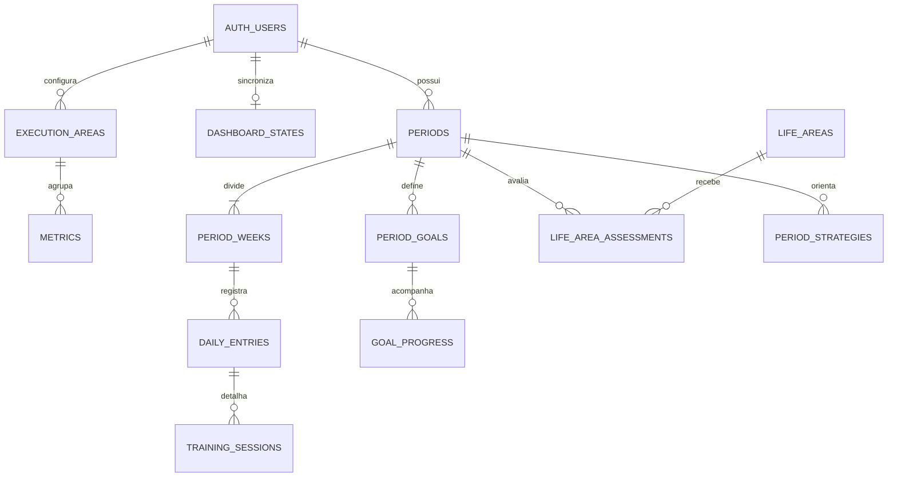

# Arquitetura
Next.js App Router, React, CSS responsivo e Supabase Auth/PostgreSQL. O modo local persiste no navegador; conectado, o mesmo documento de estado é isolado por usuário com RLS. Uma camada de repositório permite trocar essa persistência por operações normalizadas sem alterar o motor de cálculo.

## Relações e schema
Usuário → períodos → semanas → registros diários e treinos. Período → objetivos e avaliações de vida. Áreas → métricas. Cada semana contém snapshot completo de metas, pesos de métricas e pesos de áreas. O SQL inclui essas entidades e um documento de estado para a primeira versão da aplicação.

## Score
Cumprimento = realizado / meta. A interface pode mostrar valores acima de 100%; cálculo limita cada componente a 100%. Meta zero não participa. Revisões de call têm meta derivada das calls realizadas. Saúde usa quatro componentes independentes: treinos, musculação, qualidade >=4 e qualidade 5. Média ponderada dentro da área; média ponderada das áreas aplicáveis no geral. Resultados não participam.

## Tempo
Progresso limitado a [0,1] = (agora-início)/(fim-início). Tempo virtual = progresso ×365 dias, sobre calendário UTC não bissexto. No fim exibe 31/dez 23:59. Datas reais usam America/Sao_Paulo. Semanas são blocos de sete dias a partir do início do período, não semanas civis. O início requer configuração explícita. Apenas um ciclo pode estar ativo.

## Projeções e inconsistências
Fluxos (clientes e receita) usam realizado/progresso. Estoques (caixa e investimentos) usam saldo inicial + variação/progresso. Sem progresso não há projeção. Peso e aparência corporal não têm projeção linear. Sem registros, execução é zero, não sucesso. Dados ilustrativos ficam num ciclo demonstrativo separado. Datas podem ter duração diferente de 84 dias; interface calcula a duração real. Metas editadas aplicam-se somente à semana selecionada e aos padrões futuros, mantendo outros snapshots.

## Evolução
Integrações futuras escrevem através do repositório autenticado. Para grande volume, migrar documentos para as entidades normalizadas, com transações e validação no servidor. Fotos e integrações externas não fazem parte desta versão.

## Relações detalhadas

As metas e os pesos pertencem aos snapshots de `period_weeks`. `metrics.default_target` define somente o padrão de ciclos futuros. A aplicação inicial grava estes objetos no documento por usuário; as relações normalizadas servem como contrato para a migração da camada de persistência.
